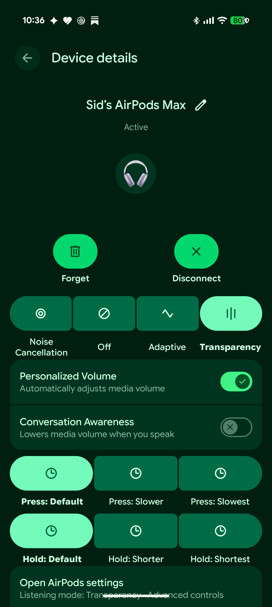
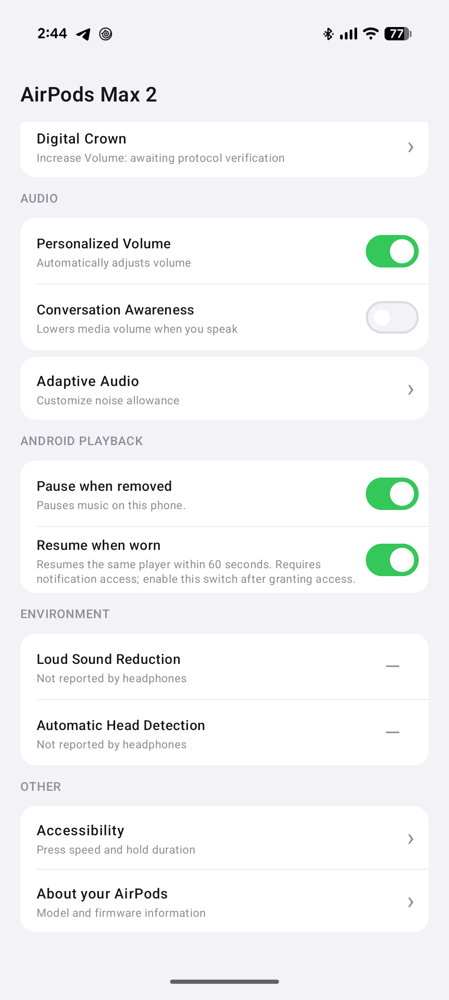

  

<h1 align="center">OpenPodsMax</h1>

AirPods Max on Android. Native controls, familiar settings.

  <a href="https://github.com/sidnvy/OpenPodsMax/releases/latest">Download APK</a> ·
  <a href="https://github.com/sidnvy/OpenPodsMax/releases/tag/v0.2.1">Release notes</a> ·
  <a href="https://github.com/sidnvy/OpenPodsMax/issues">Feedback</a>

Bring AirPods Max 2 controls into Android’s **Connected devices**, alongside a dedicated **Apple-inspired settings page**. No cloud account required.

  
  &nbsp;&nbsp;
  

<em>Android device details after registration (left) · Dedicated settings (right)</em>

Real Pixel 10 Pro XL captures from the private test build. **System integration is experimental:** it requires separate ADB registration and can reset after Bluetooth cycles or system updates. Installing the APK alone enables the dedicated app. [Screenshot details](docs/images/README.md).

## Features

- Control listening modes and supported headset settings inside Android Settings after experimental registration.
- Use an Apple-inspired settings page for battery, audio controls and accessibility options.
- Switch between Noise Cancellation, Transparency, Adaptive and Off.
- Adjust supported settings including Personalized Volume and Conversation Awareness.
- Automatically pause when removed and resume the same player when worn; manual pauses stay paused.
- Switch phones manually without the inactive phone continually reclaiming the headset.

## Get started

You need **AirPods Max 2** and **Android 12L+ (API 32+)**. Hardware testing covers **Pixel 10 Pro XL** and **Motorola Edge 70** on API 37; other devices and versions are unverified.

1. Install the signed APK from [Releases](https://github.com/sidnvy/OpenPodsMax/releases/latest).
2. Pair and connect your headset in Android Bluetooth settings.
3. Open OpenPodsMax, grant Bluetooth access and approve the selected Max 2.
4. Optionally enable **Pause when removed** and **Resume when worn**. Resume requires notification access.

Ordinary app use needs no root or Shizuku. Native system integration requires additional device-specific setup. Simultaneous multipoint and Apple-style automatic switching are not implemented.

This is an **early public release**. See [compatibility and setup notes](docs/COMPATIBILITY.md) for system integration, permissions, migration from debug builds and known limitations.

## Build & contribute

See [BUILDING.md](BUILDING.md) to build and test the app, and [release verification](docs/RELEASING.md) for APK checksums and signing. Contributions are welcome through [Issues](https://github.com/sidnvy/OpenPodsMax/issues) and pull requests.

Include your phone model, Android version, headset firmware and reproduction steps in bug reports. Keep credentials, device addresses and personal information out of public logs and screenshots. See [Contributing](CONTRIBUTING.md) and [Security](SECURITY.md).

## License & acknowledgments

[GPLv3](LICENSE) · [Third-party notices](NOTICE.md) · [Permissions & privacy](docs/COMPATIBILITY.md#permissions-and-privacy)

Built by sid. Thanks to CAPod and LSPosed for the work acknowledged in the third-party notices.

OpenPodsMax is an independent project, not affiliated with Apple or Google. AirPods is an Apple trademark.
